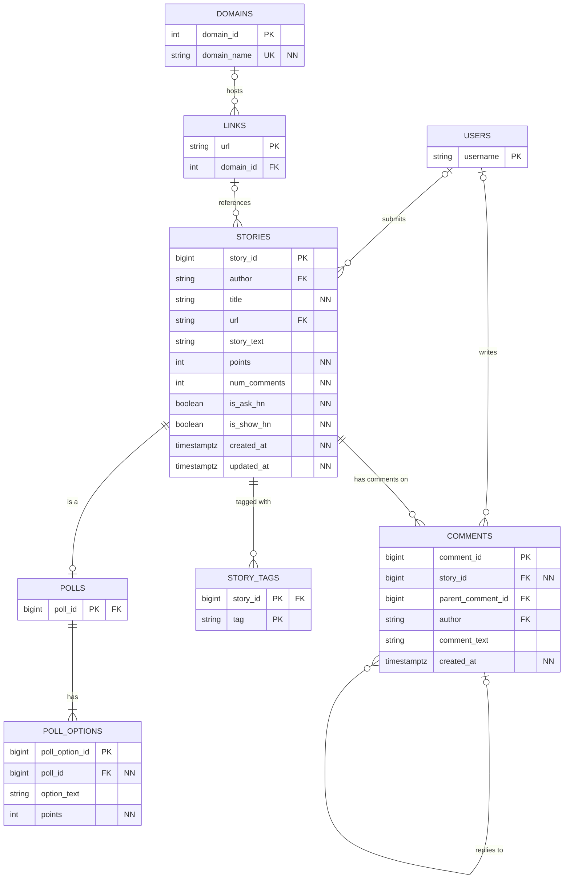

# Current schema

NN means NOT NULL; primary keys are implicitly required. `user_first_seen` is a derived view over loaded stories/comments and is not a stored entity. The PNG is the historical Project 1 diagram.

